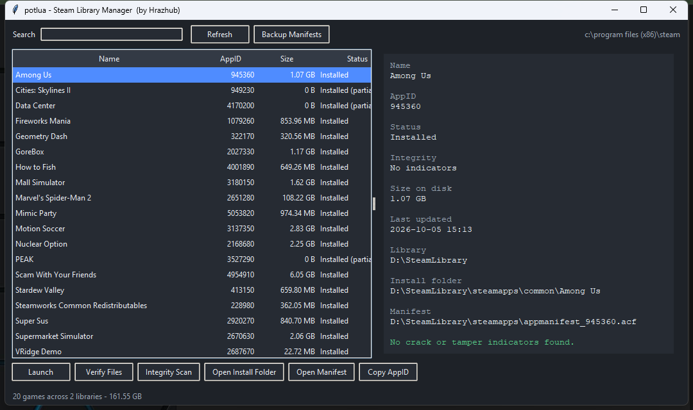

# potlua

A lightweight Windows desktop app for browsing your Steam library, backing up manifests, verifying game files, and scanning installed games for tampering.

Built with Python and Tkinter. Ships as a single portable executable — no installer, no background service, no account login.



## Features

- **Auto library detection** — finds your Steam install and every additional library folder via `libraryfolders.vdf`.
- **Full library overview** — name, AppID, size on disk, install status, integrity result, and last update time.
- **Search and sorting** — filter by game name or AppID, click any column heading to sort.
- **Integrity scan** — flags emulator DLLs, release-group artifacts, `steam_appid.txt`, and unrecognized `steam_api` builds.
- **Quick actions** — launch a game, request Steam file verification, open the install folder or manifest, copy the AppID.
- **Manifest backup** — export every `appmanifest_*.acf` to a timestamped folder before a reinstall or drive move.
- **Portable** — one `.exe`, nothing to install.

## Requirements

- Windows 10 or 11 (64-bit)
- Steam installed (the app locates it via the registry, with fallback paths)

## Download

Grab the latest portable build:

- [`dist/potlua.exe`](dist/potlua.exe)
- [`site/downloads/potlua.exe`](site/downloads/potlua.exe)

Run it directly. Nothing is installed and no files are modified.

## Usage

1. Start `potlua.exe`.
2. The app scans your Steam libraries and lists every installed game.
3. Select a game to see details and run an automatic integrity check on first view.
4. Use the bottom buttons to launch, verify, open folders, copy the AppID, or back up manifests.

Use **Refresh** to rescan after installing or removing games, and **Integrity Scan** to check the whole library at once.

### Integrity results

| Result | Meaning |
| --- | --- |
| **No indicators** | No emulator, release-group, or tampered-DLL markers found. |
| **Modified** | Medium-severity findings only, such as release-group names or `steam_appid.txt`. |
| **Suspicious** | At least one high-severity finding, such as an emulator marker or a non-Valve `steam_api` build. |
| **Unknown** | The install folder was missing or contained no files. |

Scans are heuristic and read-only. A finding is a hint, not proof.

## Build from source

Requires Python 3.9+ with Tkinter.

Run from source:

```powershell
python potlua.py
```

Build the standalone executable with PyInstaller:

```powershell
pip install pyinstaller
pyinstaller potlua.spec
```

The build outputs `dist/potlua.exe`.

## Project layout

```
potlua.py        Main application (UI, VDF parsing, library scanning, integrity checks)
potlua.spec      PyInstaller build configuration
dist/            Built executable
site/            Static landing page and download mirror
```

## How it works

potlua reads Steam metadata locally:

- Locates the Steam root via the Windows registry, then falls back to the default install paths.
- Reads `steamapps/libraryfolders.vdf` to find all library folders.
- Parses each `appmanifest_*.acf` for name, AppID, size, state flags, and install directory.
- Walks each game's install folder (two levels deep) looking for emulator and release-group markers.
- Inspects `steam_api.dll` / `steam_api64.dll` for known emulator strings and expected Valve signatures.

No game files are written to, and nothing is uploaded anywhere.

## Limitations

- Windows only (uses `winreg` and `os.startfile`).
- Integrity detection is signature-based and may produce false positives or miss newer tooling.
- Uninstalled games without an `appmanifest` are not listed.
- Games installed outside a Steam library are not detected.

## Disclaimer

potlua only reads local Steam files. It does not download, unlock, modify, or distribute games. Not affiliated with Valve Corporation. Use at your own risk.
